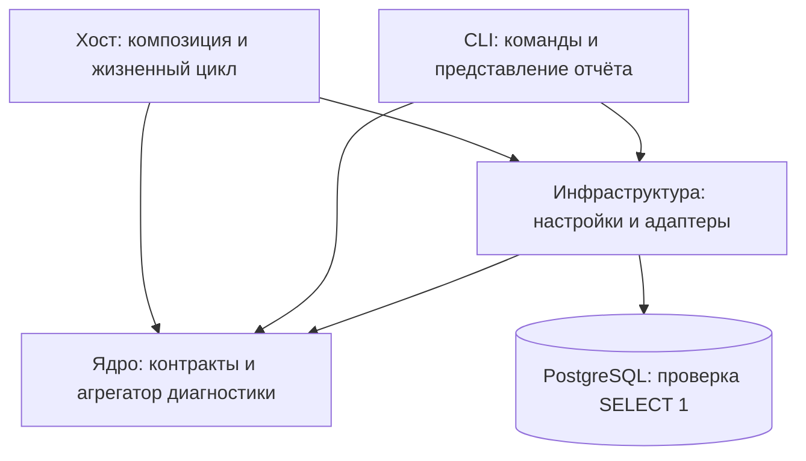

# Архитектура

[Все руководства](README.md) · [Запуск](operations.md)

Архитектурная карта помогает выбрать место изменения и понять, что проверяет
запущенный процесс. Сейчас это один процесс приложения и одна PostgreSQL,
а не набор распределённых сервисов.

Стрелки между проектами показывают зависимости. Хост и CLI собирают свои
зависимости, Infrastructure предоставляет адаптеры, Core не знает о способе
запуска и базе данных. Стрелка к PostgreSQL означает обращение во время работы.

| Компонент | Ответственность | Где смотреть |
| --- | --- | --- |
| Core | `DiagnosticsRunner`, отчёты, статусы, коды выхода; без пакетов NuGet | [Исходники](../src/AnketaParser.Core/) |
| Infrastructure | Общая конфигурация, валидаторы, проба Npgsql, снимок процесса, последнее состояние готовности | [Исходники](../src/AnketaParser.Infrastructure/) |
| Host | Generic Host — управление запуском и остановкой; начальная диагностика и периодический монитор | [HostApplication](../src/AnketaParser.Host/HostApplication.cs) |
| Cli | Разбор аргументов, справка, версия, текст и JSON диагностики | [CliApplication](../src/AnketaParser.Cli/CliApplication.cs) |
| Unit-тесты | Контракты без внешних сервисов | [AnketaParser.Tests](../tests/AnketaParser.Tests/) |
| Docker smoke | Изолированный запуск настоящих контейнеров и проверка сохранности тестовых данных | [AnketaParser.DockerTests](../tests/AnketaParser.DockerTests/) |

`AddAnketaParserInfrastructure` регистрирует адаптеры; композиция остаётся в
исполняемых проектах. Хост и CLI используют один `DiagnosticsRunner`, поэтому
логика проверки PostgreSQL не копируется. Пробы выполняются последовательно,
каждая получает ограничение времени и сигнал отмены. Снимок окружения снимается
для отчёта, последнее состояние хоста хранится в памяти, без отдельного сервиса.

Проверка `SELECT 1` подтверждает соединение с БД, но не создаёт таблиц и не
проверяет прикладную схему. Парсинг анкет, профили, Telegram, LLM, доменная
персистентность, миграции, HTTP API и MCP не реализованы. Также нет EF Core,
pgvector, Redis, RabbitMQ и очереди заданий. Подробности границ — в
[безопасности и ограничениях](security.md).

Если процесс запущен, но непонятно, готова ли БД, используйте
[диагностику](diagnostics.md): сам факт существования процесса готовность не доказывает.
