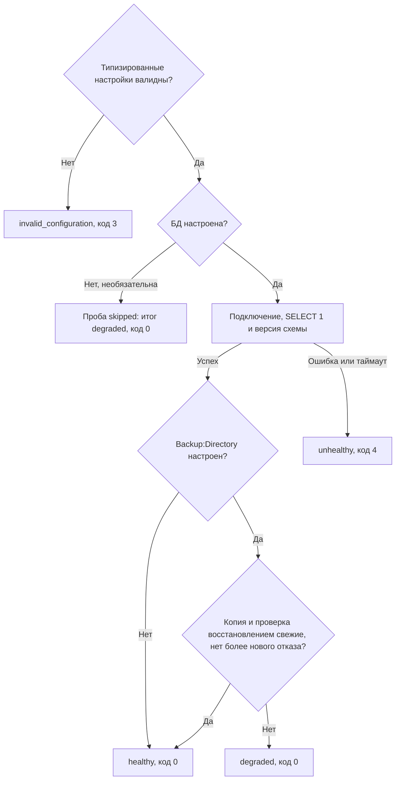

# CLI, диагностика и готовность

[Все руководства](README.md) · [Настройки](configuration.md) · [Эксплуатация](operations.md)

CLI позволяет проверить настройки и доступность PostgreSQL без запуска
долгоживущего хоста. **Готовность** (readiness) означает результат проверки
зависимости; **жизнеспособность** (liveness) — что процесс ещё работает.

## Команды

Из корня репозитория, в PowerShell или Bash/WSL:

```sh
dotnet run --project src/AnketaParser.Cli -- --help
dotnet run --project src/AnketaParser.Cli -- --version
dotnet run --project src/AnketaParser.Cli -- doctor
dotnet run --project src/AnketaParser.Cli -- doctor --json
```

| Аргумент | Результат |
| --- | --- |
| Без команды, `help`, `-h`, `--help` | Текст справки, код `0`; даже с `--json` справка остаётся текстом |
| `version`, `-v`, `--version` | Название и версия; с `--json` — короткий JSON |
| `doctor` | Проверка конфигурации, снимок окружения и пробы |
| `--json` | Режим машинного вывода для `doctor` и `version` |

При обычном `doctor` отчёт идёт в stdout, ошибки и логи — в stderr.
При успешно обработанном `doctor --json` stdout содержит ровно один JSON-документ;
логи остаются в stderr. Не объединяйте потоки перед разбором JSON. Чтобы исключить
вывод сборки из машинного канала, после сборки вызывайте DLL напрямую.

Воспроизводимый сценарий PowerShell после Release-сборки из
[руководства разработчика](development.md):

```powershell
$reportText = dotnet src/AnketaParser.Cli/bin/Release/net10.0/AnketaParser.Cli.dll doctor --json
$doctorExitCode = $LASTEXITCODE
$report = $reportText | ConvertFrom-Json
$report.status
$doctorExitCode
```

Без настроенной БД ожидайте `degraded` и `0`, а у пробы PostgreSQL — `skipped`.
В Bash/WSL можно сохранить потоки раздельно во временный каталог:

```bash
report_dir=$(mktemp -d)
dotnet src/AnketaParser.Cli/bin/Release/net10.0/AnketaParser.Cli.dll doctor --json > "$report_dir/doctor.json" 2> "$report_dir/doctor.log"
doctor_exit_code=$?
cat "$report_dir/doctor.json"
printf '%s\n' "$doctor_exit_code"
```

Это диагностические файлы, не материалы для коммита. Настроенная в окружении БД
изменит ожидаемый результат.

## Состояния и коды выхода



Диаграмма показывает обычный путь `doctor`; обязательная БД без строки
подключения отвергается ещё валидатором. Непредвиденные исключения обрабатываются
отдельно, поэтому не следует считать любой отказ полноценным JSON-отчётом.

| Код | Смысл и следующее действие |
| --- | --- |
| `0` | Команда успешна; для `doctor` проверьте ещё `status`: `degraded` не означает готовую БД |
| `1` | Внутренняя ошибка; изучите stderr, JSON может отсутствовать |
| `2` | Неверные аргументы; вызовите справку |
| `3` | Ошибка чтения JSON, типов или валидации настроек; исправьте конфигурацию |
| `4` | Настроенная зависимость недоступна; проверьте подключение и PostgreSQL |

CLI возвращает `4` при любой настроенной недоступной БД, включая
`Database:Required=false`. Host при начальной проверке с такой необязательной
БД продолжает работать, сохраняя нездоровый результат; при `Required=true`
отказывает в старте с `4`. Периодический монитор обновляет состояние и логи,
но не останавливает Host при последующей потере БД.

## Машинный документ

Схема определена в [DiagnosticsDocument](../src/AnketaParser.Cli/DiagnosticsDocument.cs),
представление — в [CliApplication](../src/AnketaParser.Cli/CliApplication.cs),
коды — в [ExitCodes](../src/AnketaParser.Core/ExitCodes.cs).

| Группа | Поля и смысл |
| --- | --- |
| Корень | `schemaVersion` (`1`), `tool`, `toolVersion`, `command`, `generatedAtUtc`, `status`, `exitCode` |
| `runtime` | `framework`, `os`, `architecture`, `isContainer`, `machineName`, `processId`, `uptimeSeconds`, `instanceName`, `environment` |
| `configuration` | `valid`, `sources` (пары `name`/`kind`), `database` |
| `configuration.database` | `configured`, `required`, `target`, `connectTimeoutSeconds`; `target` — описание без учётных данных |
| `probes[]` | `name`, `status`, `detail`, `durationMs` |
| `errors[]` | Список ошибок аргументов или валидации; в штатном отчёте пуст |

`runtime` отсутствует при ошибках аргументов и валидации; nullable-поля со
значением null не сериализуются. `sources[].kind` — `file` или `environment`.
Значения общего `status`: `healthy`, `degraded`, `unhealthy`,
`invalid_configuration`, `invalid_usage`. У проб: `healthy`, `skipped`, `unhealthy`.
Ошибки аргументов дают `command: "unknown"`. Флаг `--json` распознаётся в любой
позиции, в том числе после ошибочного аргумента. Допускается не более одной команды;
повторы и сочетания вроде `doctor version` возвращают код `2`.
Повреждённый JSON и неверные типы настроек дают код `3` в Host и CLI;
`doctor --json` возвращает `invalid_configuration` без исходных значений и секретов.

<details>
<summary>Иллюстрация полного отчёта без настроенной БД</summary>

Значения времени, версии и окружения условны; это не запись выполненного запуска.

```json
{
  "schemaVersion": 1,
  "tool": "anketa-parser",
  "toolVersion": "0.1.0",
  "command": "doctor",
  "generatedAtUtc": "2026-01-01T00:00:00+00:00",
  "status": "degraded",
  "exitCode": 0,
  "runtime": {
    "framework": ".NET 10.0.14",
    "os": "Linux",
    "architecture": "X64",
    "isContainer": false,
    "machineName": "local",
    "processId": 123,
    "uptimeSeconds": 0.1,
    "instanceName": "anketa-parser",
    "environment": "Production"
  },
  "configuration": {
    "valid": true,
    "sources": [
      { "name": "appsettings.json", "kind": "file" },
      { "name": "environment variables (ANKETAPARSER_*)", "kind": "environment" }
    ],
    "database": {
      "configured": false,
      "required": false,
      "target": "(not configured)",
      "connectTimeoutSeconds": 5
    }
  },
  "probes": [
    {
      "name": "postgres",
      "status": "skipped",
      "detail": "База данных не настроена; готовность не подтверждена.",
      "durationMs": 0
    }
  ],
  "errors": []
}
```

</details>

`version --json` содержит только `schemaVersion`, `tool`, `toolVersion`,
`command: "version"`, `exitCode`. Не разбирайте его как полный отчёт `doctor`.

## Диагностика хоста

Начальная проверка обновляет `ReadinessStateStore`. При отключённой начальной
диагностике готовность на старте не проверяется. Монитор работает только с
настроенной БД и положительным интервалом: на уровне `Information` пишет смену
статуса, на `Debug` — также неизменившийся статус. Без БД пустой цикл не запускается.

| EventId | Наблюдение |
| --- | --- |
| `1001` | Начальная диагностика выключена |
| `1002` / `1003` | Итог начальной диагностики / результат пробы |
| `1004` / `1005` | Отказ старта из-за обязательной БД / продолжение при необязательной |
| `2001` | Ошибка пробы PostgreSQL |
| `3001` / `3002` | Монитор выключен / не нужен без настроенной БД |
| `3003` / `3004` / `3005` / `3006` | Запуск / смена / неизменность / остановка монитора |

Хост использует структурированные `ILogger`-события, отдельного файлового журнала
нет. Docker healthcheck запускает новый CLI-процесс внутри контейнера;
он не читает хранилище готовности хоста. Детали безопасной работы с логами —
в [руководстве по безопасности](security.md).

## Схема и резервирование

Проба postgres требует совместимой истории миграций; успешного подключения недостаточно.
При настроенном Backup:Directory добавляется проба backup с датами успеха/отказа
и проверки восстановлением. Отсутствие свежего подтверждения даёт degraded.
JSON расширяется элементом существующего массива probes; ключи и коды выхода сохранены.
[Команды и условия готовности](persistence.md).
